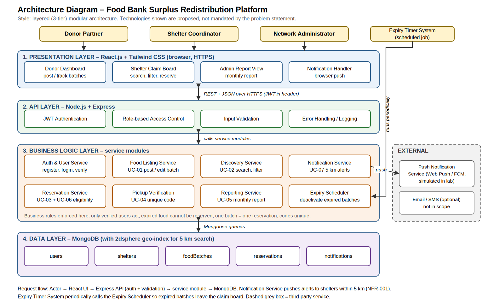

# MyProject_FoodBankSurplus – Food Bank Surplus Redistribution Platform

**Student:** Manoj Shrikant Gaonkar | **SRN:** PES1UG25CS827 | **Section:** H | **Faculty:** Ambika K  
**Course:** Software Engineering, PES University, Dept. of CSE | **Problem Statement:** #62 – Sustainability & Green Tech

A food rescue platform where restaurants and grocery stores post surplus edible food batches, and verified local shelters reserve pickup windows before food expiry.

## Repository structure

Coursework is organized by lab number. Labs 1–7 are included; Lab 7 extends the reference repository's six-lab structure.

| Folder | Contents |
|---|---|
| [LAB_1](LAB_1/) | Requirements engineering, use cases, SRS and WBS |
| [LAB_2](LAB_2/) | GitHub/Jira project setup, Kanban, Scrum and bug tracking |
| [LAB_3](LAB_3/) | System architecture diagram |
| [LAB_4](LAB_4/) | GitHub Copilot work, software testing-tools bug-fix evidence, and related project source versions |
| [LAB_5](LAB_5/) | Static code analysis: Pylint, Bandit and Flake8 |
| [LAB_6](LAB_6/) | Code and branch coverage for the car-rental module |
| [LAB_7](LAB_7/) | Hypothesis-based fuzz testing |

